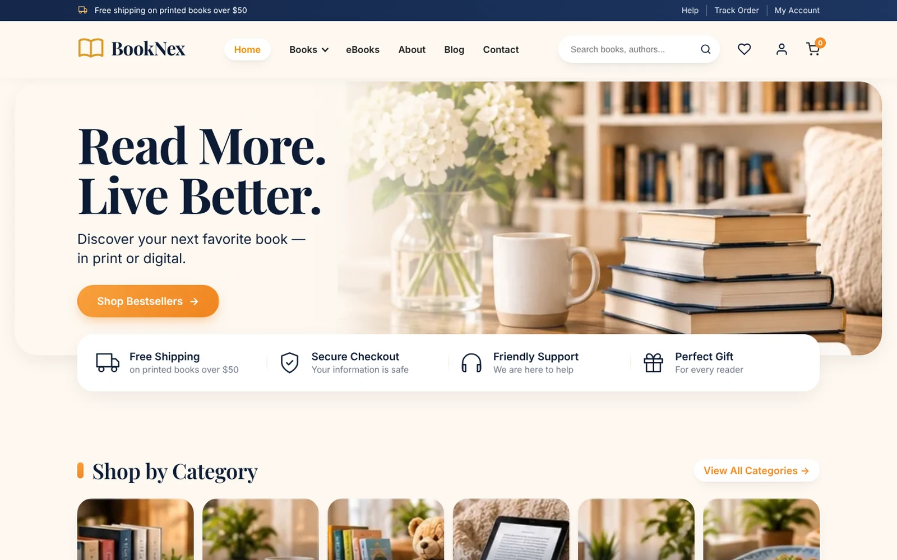
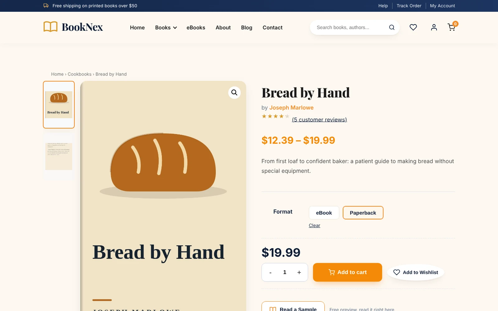
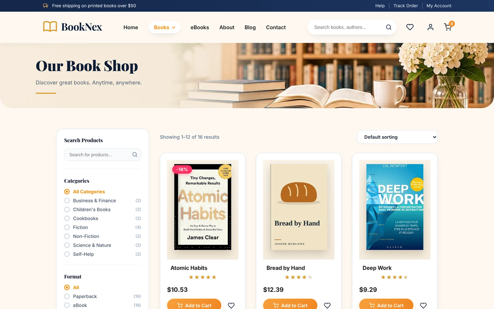
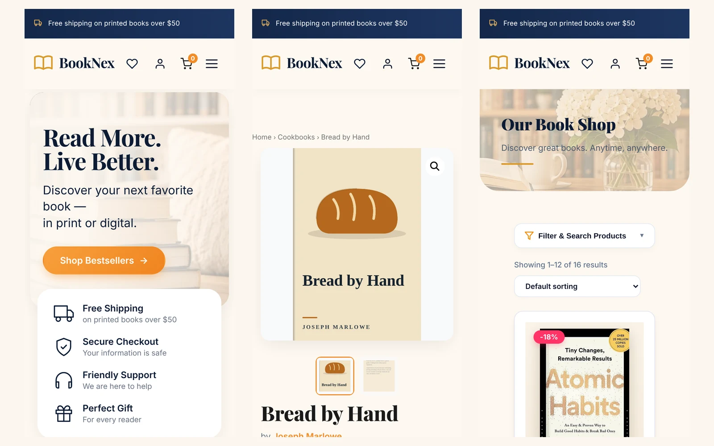
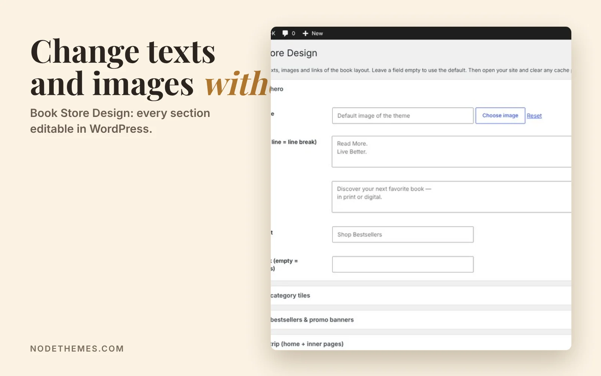

# BookNex – WooCommerce bookstore theme for WordPress

**A WooCommerce theme for bookshops: paperback and eBook in one product, protected downloads, reading samples and filters by author and format.**

BookNex is a premium WordPress theme by [NodeThemes](https://nodethemes.com). It is built for shops that sell books: one title can be a paperback and an eBook, readers can try the first pages, and the shop can be filtered by author and format. Colors, header, footer and the sections of every page are set in one settings panel.

> This repository is a **showcase**: it holds screenshots and information, not the theme code. The theme is sold at nodethemes.com with a yearly license that includes updates and support.

- **Website:** https://nodethemes.com/product/booknex-bookstore-woocommerce-theme/
- **Guide:** [How to sell books online with WordPress and WooCommerce](https://nodethemes.com/sell-books-online-with-wordpress/)
- **Free WordPress plugins by NodeThemes:** https://nodethemes.com/free-plugins/

## Features

- **Paperback and eBook in one product:** designed for WooCommerce variable products with a Format attribute, so reviews and links are shared.
- **Reading samples:** a sample of the first pages on the product page; the full eBook stays in WooCommerce's protected downloads.
- **Shop filters:** filter by author, format and more with WooCommerce attributes.
- **Shipping messages:** a shipping bar that fits mixed and eBook-only carts.
- **One settings panel:** colors, header, footer and the sections, texts and photos of every page.
- **Demo content:** sample books, categories and reading-sample PDFs you can import after activation.
- **Responsive:** laid out for phones, tablets and desktops.

BookNex does not replace WooCommerce: you use WooCommerce for products, orders, payments and taxes.

## Screenshots

## Requirements

WordPress 6.4 or newer, PHP 7.4 or newer, and WooCommerce.

## Support

- E-mail: nodethemes.com@gmail.com
- WhatsApp: +44 7441 429969
- Telegram: https://t.me/nodethemes

© NodeThemes. WordPress and WooCommerce are trademarks of their owners.
